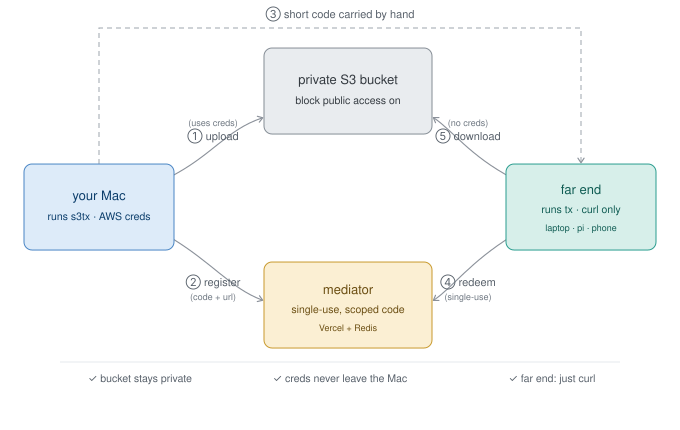

# s3tx

> Move files in and out of a locked-down environment through a **private** S3 bucket,
> using time-limited pre-signed URLs. The far end needs nothing but `curl`.


`s3tx` runs on a trusted machine (your Mac) that holds AWS credentials. It uploads to a
bucket that is **never public**, then hands the other end a short-lived signed link — or
an even shorter *code*. The far end (a work laptop behind a corporate proxy, a phone, a
Raspberry Pi) downloads or uploads with plain `curl`: no AWS account, no CLI, no creds.



## Why

- **The bucket is never public.** Block Public Access stays fully on. Access is granted
  per-object, time-boxed, by a signed URL — not by a bucket policy.
- **Zero credentials on the far end.** It only ever sees a URL or a short code.
- **Least privilege on the trusted side.** `s3tx` uses a dedicated AWS profile bound to a
  narrow IAM user (see [`iam-policy.json`](iam-policy.json)) — never your shell default.
- **One file, no install dance.** A single script with [PEP 723](https://peps.python.org/pep-0723/)
  inline dependencies; [uv](https://docs.astral.sh/uv/) fetches `boto3` on first run.

## Install (the Mac)

```sh
git clone https://github.com/junior/s3tx.git && cd s3tx
install -m 755 s3tx ~/bin/s3tx      # or anywhere on your $PATH
```

<sub>The shebang uses `uv run --script`, so the first invocation provisions `boto3`
automatically — no virtualenv, no `pip install`.</sub>

One-time AWS setup: a private bucket (Block Public Access on) and an IAM user with the
policy in [`iam-policy.json`](iam-policy.json), wired to a dedicated profile:

```sh
aws configure --profile s3tx
s3tx status        # confirm the identity + that the bucket is private
s3tx lockdown      # force Block-Public-Access on, drop any bucket policy
```

## Quickstart

**Send a file out** — the other end downloads it:

```sh
s3tx send report.pdf
#  → prints a time-limited download link
# on the far end:
curl -L -O "<that link>"
```

**Receive a file in** — the other end uploads, with no credentials:

```sh
s3tx drop inbox/photo.jpg
#  → prints a time-limited upload (PUT) link
# on the far end:
curl -X PUT --upload-file photo.jpg "<that link>"
# then pull it here:
s3tx recv inbox/photo.jpg
```

## Short codes

Pasting a 500-character URL is miserable. `s3tx` can hand the far end a short code instead,
redeemed by the bundled [`tx`](tx) client (install + config below):

| Flag | Mechanism | Far end needs | Best for |
|------|-----------|---------------|----------|
| `--to CLIENT` | [mediator](mediator/) (Vercel + Redis) | its `TX_CLIENT_ID` | single-use, **scoped** to one machine |
| `--code [CODE]` | a private manifest object in the bucket | the manifest seed URL | no third-party service |
| *(neither)* | the raw signed URL | — | one-off, nothing to set up |

```sh
s3tx send report.pdf --to laptop      # → "tx get a3Kf9p2Q" on that machine
```

The mediator path is the strongest: each code is single-use, expires, is scoped to exactly
one client, and brute-force is rate-limited. See [`mediator/`](mediator/) to deploy it.

## The far end (`tx`)

The companion client is [`tx`](tx) — a single POSIX-shell script (~120 lines) that needs
only `curl`. It runs anywhere with a shell: Linux, WSL, a Raspberry Pi, even a phone.

**Install** it on the far-end machine:

```sh
curl -fsSL https://raw.githubusercontent.com/junior/s3tx/main/tx -o ~/.local/bin/tx
chmod +x ~/.local/bin/tx          # make sure ~/.local/bin is on your $PATH
```

That one self-contained file is **all** the far end needs. Don't `git clone` the repo onto a
locked-down box — the rest (`s3tx`, `mediator/`, the IAM policy) is AWS-side tooling that has
no business there, and `tx` never depends on it.

**Configure once** in `~/.config/tx/config` (chmod 600 — `TX_CLIENT_ID` is a secret). For
the mediator backend (matches `s3tx … --to <client>`):

```sh
mkdir -p ~/.config/tx
cat > ~/.config/tx/config <<'EOF'
TX_MEDIATOR=https://your-mediator.vercel.app
TX_CLIENT_ID=your-machines-client-id      # this box's clientID — see mediator/
EOF
chmod 600 ~/.config/tx/config
```

Prefer the manifest backend (`s3tx … --code`, no third party)? Run `s3tx manifest-url` on
the Mac — it prints the exact commands to set `TX_MANIFEST` or write
`~/.config/tx/manifest.url`. Environment variables always override the config file.

**Use it:**

```sh
tx get <code>              # resolve a code → download
tx get <code> out.pdf      # …to a chosen filename
tx put ./photo.jpg <code>  # upload a file to a `drop` code (use - for stdin)
tx get "<https url>"       # a raw pre-signed URL works too, with no config at all
```

Anything starting with `http(s)://` is used directly; otherwise it's treated as a short
code and resolved via the mediator or the manifest.

## Commands

| Command | Does |
|---------|------|
| `send FILE [KEY]` | upload a file (or stdin with `-`), print a download link |
| `link KEY` | fresh code/link for an object already in the bucket |
| `drop KEY` | print an upload link so the far end can push a file (no creds) |
| `recv KEY [OUT]` | download an object to this machine |
| `ls [PREFIX]` | list objects |
| `rm KEY` | delete one object |
| `rmrf` | delete every object (asks for confirmation) |
| `status` | show identity, bucket, and confirm the bucket is private |
| `lockdown` | force Block-Public-Access on, remove any bucket policy |
| `manifest-url` | print a long-lived seed URL for `--code` (max 7 days) |
| `codes` | list live manifest codes |

### Many files

`s3tx` reads and writes stdin, so pipe a tarball straight through it:

```sh
# you → far end
tar czf - file1 dir/ | s3tx send - bundle.tgz --to laptop
#   far end:  tx get CODE          (then: tar xzf bundle.tgz)

# far end → you
s3tx drop bundle.tgz --to laptop
#   far end:  tar czf - f1 dir/ | tx put - CODE
s3tx recv bundle.tgz               # then: tar xzf bundle.tgz
```

## Configuration

All via environment variables:

| Variable | Default | Meaning |
|----------|---------|---------|
| `S3TX_PROFILE` | `s3tx` | dedicated AWS profile; set empty to use the standard boto3 chain |
| `S3TX_BUCKET` | `s3tx` | bucket name |
| `S3TX_REGION` | `us-east-1` | bucket region |
| `S3TX_EXPIRES` | `600` | link lifetime in seconds (clamped to the 7-day SigV4 max) |
| `S3TX_MANIFEST_KEY` | `.s3tx-manifest` | key of the private manifest object (for `--code`) |
| `S3TX_MEDIATOR` | — | mediator base URL (for `--to`) |
| `S3TX_ADMIN_TOKEN` | — | mediator admin bearer token (for `--to`) |

## Security model

- A pre-signed URL is a **bearer token**: whoever holds it has the access it encodes until
  it expires. `s3tx` prints the expiry and treats URLs as secrets — keep them out of shared
  logs and chat history.
- The bucket stays private; `s3tx status` checks Block-Public-Access and `s3tx lockdown`
  enforces it.
- Credentials never leave the trusted machine, and the IAM user is scoped to one bucket.
- **Mediator codes** (`--to`) are single-use, scoped to one client, and rate-limited.
- **Manifest codes** (`--code`) are simpler but weaker: the *seed URL* from
  `s3tx manifest-url` (valid up to 7 days) grants read of the whole manifest. Prefer `--to`
  when you have the mediator, and treat the seed URL itself as a secret.

## The mediator

`--to` needs the small Vercel app in [`mediator/`](mediator/) — it maps a short code to a
pre-signed URL with single-use, per-client scoping, and rate-limiting. It only ever holds
short-lived URLs and never your AWS credentials. Setup and the threat model are in
[`mediator/README.md`](mediator/README.md).

## Development

```sh
uvx ruff check .                                   # lint
uvx ruff format .                                  # format
uv run --with pytest python -m pytest tests/ -q    # unit tests (no AWS needed)
```

CI ([`.github/workflows/ci.yml`](.github/workflows/ci.yml)) runs all three, plus
`node --check` on the mediator functions and `shellcheck` on `tx`.

## License

[MIT](LICENSE).
